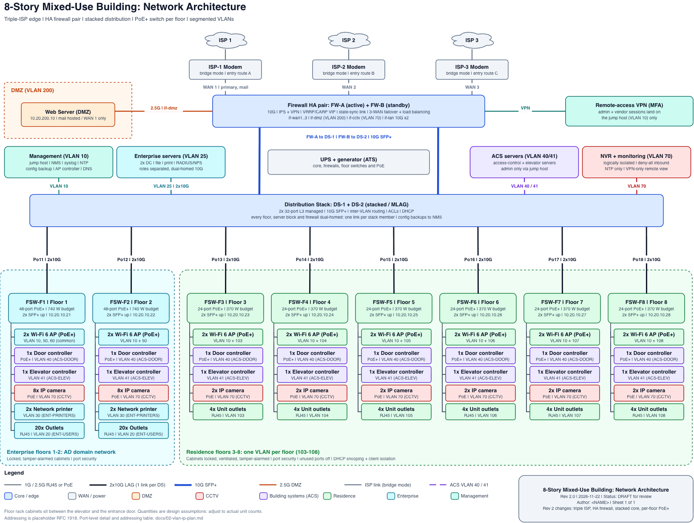

# Mixed-Use Building Network 

Network design for an 8-story mixed-use building: **2 enterprise floors** (1-2) and **6 residential floors** (3-8), with
building systems (doors, elevators), CCTV, a DMZ and central services. The repo holds the architecture, requirements,
design decisions, security and operations docs, device configs, and data tables (VLANs, IPs, ports, equipment).

> Based on a real building. Everything here is sanitized: private RFC 1918 addresses only, secrets are `<REDACTED>`.



## Highlights
- **Triple-ISP edge** with bridge-mode modems on diverse entry routes; WAN 1 pinned for mail/VPN/DMZ, WAN 2 + 3 balanced
- **HA firewall pair** and a **stacked L3 distribution pair**; every floor, server block and firewall link is dual-homed
- **PoE+ switch on every floor** with 2x10G LACP uplinks (one link to each core switch)
- **Segmentation:** VLAN per residence floor, AD-managed enterprise network, separate door/elevator VLANs (ACS, not routed), guest Wi-Fi
- **CCTV as a logically isolated zone:** deny-all inbound, NTP only, VPN-only viewing (28 cameras)
- **Hardened access layer:** port security, DHCP snooping, protected ports, locked and tamper-alarmed cabinets
- **Single admin path:** MFA VPN to a jump host, with monitoring, NTP and backups on the management VLAN

## Repository layout

```
mixed-use-building-network/
├── README.md
├── LICENSE
├── .gitignore
├── CHANGELOG.md
├── docs/
│   ├── architecture.md                  Design overview, floor build, flows, redundancy, capacity
│   ├── requirements-and-assumptions.md  Requirements, assumptions, open questions
│   ├── design-decisions.md              Decision records and the Rev 1 to Rev 2 review log
│   ├── security.md                      Zones, access matrix, controls, publishing checklist
│   ├── operations-and-recovery.md       Monitoring, backups, runbooks, test plan
│   ├── addressing-plan.md               VLAN and IP scheme, DHCP
│   └── diagrams/
│       ├── network-architecture.drawio  Editable physical + logical diagram
│       ├── network-architecture.png     Exported diagram
│       └── vlan-and-zone-view.drawio    Zones and VLANs view
├── configs/
│   ├── README.md
│   ├── firewalls/                       Firewall policy and WAN failover policy (vendor-neutral)
│   ├── core/                            DS stack config (Cisco IOS-style)
│   └── access/                          Floor switch configs FSW-F1 ... FSW-F8
└── tables/
    ├── vlan-plan.csv
    ├── ip-address-plan.csv
    ├── port-map.csv
    └── equipment-list.csv
```

## Where to start
1. `docs/architecture.md` for the big picture, then `docs/design-decisions.md` for the why.
2. `docs/addressing-plan.md` and `tables/` for VLANs, IPs, ports and equipment.
3. `configs/` for baseline configs, and `docs/operations-and-recovery.md` to verify and run it.

## Status
- [x] Architecture, security and operations documentation
- [x] VLAN/IP plan, port map and equipment list
- [x] Baseline configs (core, 8 floor switches, firewall policy)
- [ ] Lab simulation (Packet Tracer / GNS3) and test results
- [ ] L1 / L2 / L3 split drawings, device models and cost estimate
- [ ] Per-unit isolation for residents (PPSK or private VLANs)

## Before you publish
Work through the checklist in `docs/security.md` (public addresses, secrets, identifiers, owner permission, git history).

## License
Configs and tables: MIT. Documentation and diagrams: CC BY 4.0.
