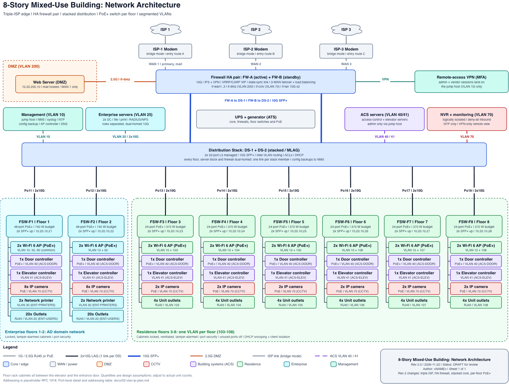

# Architecture

Editable sources: [`network-architecture.drawio`](diagrams/network-architecture.drawio) (physical + logical) and
[`vlan-and-zone-view.drawio`](diagrams/vlan-and-zone-view.drawio) (zones and VLANs only).

## Overview
An 8-story mixed-use building: **floors 1-2 enterprise**, **floors 3-8 residential**, plus building systems (doors, elevators),
CCTV, a small DMZ and central services. The network has four layers:

| Layer | Devices | Purpose |
|---|---|---|
| Internet | 3 ISPs, 3 bridge-mode modems (entry routes A/B/C) | Diverse, resilient connectivity |
| Edge | Firewall HA pair (FW-A active, FW-B standby) | NAT, IPS, VPN, 3-WAN failover, DMZ + CCTV gateways |
| Core | Distribution stack DS-1 + DS-2 (L3, 10G SFP+) | Inter-VLAN routing, ACLs, DHCP; all uplinks dual-homed |
| Access | 8 floor switches (PoE+) | Power and terminate APs, controllers, cameras, outlets |

Central services hang off the core on 10G links: **servers** (2x DC, file, print, RADIUS/NPS; VLAN 25), **management**
(jump host, NMS/syslog/NTP/backup, AP controller; VLAN 10), **ACS servers** (door + elevator; VLAN 40/41) and the **NVR** (VLAN 70).

## Floor build (as drawn)

| Floor | Type | Switch | Per-floor equipment |
|---|---|---|---|
| 1 | Enterprise | FSW-F1, 48-port PoE+, 740 W | 2 APs (VLAN 10, 50, 60 for common areas), 1 door ctrl, 1 elevator ctrl, **8 cameras**, 2 printers, 20 outlets |
| 2 | Enterprise | FSW-F2, 48-port PoE+, 740 W | 2 APs (VLAN 10, 50), 1 door ctrl, 1 elevator ctrl, **8 cameras**, 2 printers, 20 outlets |
| 3-8 | Residence | FSW-F3..F8, 24-port PoE+, 370 W | 2 APs (VLAN 10 + floor VLAN), 1 door ctrl, 1 elevator ctrl, **2 cameras**, 4 unit outlets (VLAN 103-108) |

Totals: 16 APs, 8 door controllers, 8 elevator controllers, 28 cameras, 4 printers, 64 outlets.

## Traffic flows
- **Residence to internet:** floor VLAN, DS-STACK (ACL), firewall VIP, NAT out via WAN 2/3 (WAN 1 as backup).
- **Enterprise to servers:** VLAN 20/50, DS-STACK (10G, no trunk bottleneck), VLAN 25. Optional: route via firewall for stateful logging.
- **Building systems:** door and elevator controllers talk only to the ACS servers inside VLAN 40/41. They are never routed.
- **CCTV:** cameras (VLAN 70) record to the NVR; the firewall is the VLAN 70 gateway and permits NTP only. Viewing is through the VPN and jump host.
- **Remote admin:** MFA VPN, then jump host (VLAN 10), then devices and ACS.

## Redundancy

| Failure | Effect | Why |
|---|---|---|
| One ISP down | None for users (WAN 1 pinned services fail over) | Triple ISP, gateway monitoring |
| FW-A down | FW-B takes the VIP, sessions kept | HA pair with state sync |
| DS-1 or DS-2 down | All floors and servers stay up on the other member | Every link is dual-homed across the stack |
| One floor uplink or optic | No outage beyond reconvergence | 2x10G LACP per floor |
| Floor switch down | That floor only | One switch per floor, spare on site |
| Mains loss | Core and floors run on UPS, generator takes over | UPS + generator (ATS) |

## Capacity
- **Uplinks:** 2x10G per floor (20G aggregate, a single flow tops out at 10G).
- **Wi-Fi 6 APs:** 2.5G PoE+ ports on the APs, so the AP link is not the 1G bottleneck.
- **PoE budgets (estimates, 30 W per AP, 15 W per door/elevator/camera):** residence floor 120 W of 370 W; enterprise floor 210 W of 740 W. Confirm against datasheets.
- **Firewall:** size for throughput with IPS, VPN and NAT enabled, not the headline 10G.

## Known limitations
- Single AP controller, NMS and jump host (add standbys later).
- Stateless ACLs on the core for coarse segmentation; stateful inspection stays at the firewall.
- Per-unit PPSK or private VLANs for residents are not configured.
- BMS, fire alarm, intercom and metering networks are not yet included.
